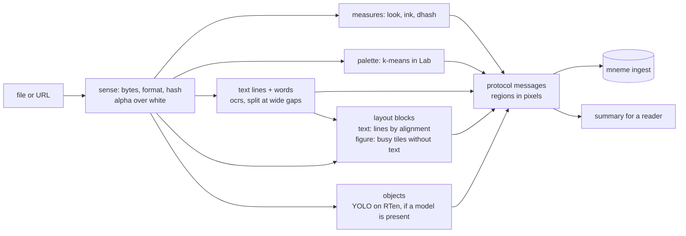

# organon-vision

**The sight organ of [organon](https://github.com/Philipjj609/organon): look at a still image (a screenshot, a diagram, a photo) and say what is where, without saying what it means.**

```bash
cargo install --git https://github.com/Philipjj609/organon-vision organon-vision
organon-vision models                 # ocrs text models, about 12 MB, once
organon-vision see shot.png https://example.org/diagram.png
mneme ingest ~/.organon/vision/runs/<time>.jsonl
```



## What comes out

One `source` per image (id = hash of its bytes), then observations located by `Location::Page { page: 1, bbox: [x, y, w, h] }` in pixels of the original image:

| kind | where | value |
|---|---|---|
| `image` | whole | width, height, `look` (dark, graphic, scene), mean, white, ink, dhash |
| `palette` | whole | colours `{hex, share}`, most frequent first |
| `text_line` | bbox | text, words with their boxes |
| `layout_block` | bbox | `role` text (its text, line height, line ids) or figure (`look`) |
| `object` | bbox | label and score, with the model in `produced_by` |

And a short Markdown view on stdout, in reading order:

```
# components-of-kubernetes.png · 1500×685 · graphic · ink 0.31
palette: #ffffff 78% · #c8d4e4 11% · #e6ebf2 5% · …
text: 16 lines (ocrs 0.14)
3. text [51,26,294,21] 21 px: Kubernetes Control Plane
9. text [347,335,204,28] 28 px: kube-api-server
…
objects: none found (objects.onnx)
```

"Not read" and "none found" are kept apart: without a text model the summary says text was not read, and no text claims are made.

## Engines

Everything is pure Rust and builds with `cargo` alone on Linux, macOS and Windows. Engines sit behind traits (`TextReader`, `ObjectDetector`), so they can be swapped.

| need | engine | why ([research](docs/DESIGN.md#research)) |
|---|---|---|
| text | [ocrs](https://github.com/robertknight/ocrs) on [RTen](https://github.com/robertknight/rten) | no C or native runtime; Latin script only, early preview |
| objects | any YOLOv8/YOLO11 ONNX export on RTen | same runtime as ocrs; `organon-vision models --objects <url or file>` |
| palette | [kmeans_colors](https://github.com/okaneco/kmeans-colors) in CIE Lab | perceptual distances, k-means++ with a fixed seed (same image, same ids) |
| layout | geometry, no model | lines grouped by alignment and spacing; figures from busy tiles |
| measures | shared with organon-video | the same ink, look and dhash numbers (pinned by a golden test) |

Models are downloaded into `$ORGANON_HOME/vision/models`, never committed. Stored copies of images go to `$ORGANON_HOME/vision/sources`.

## Library

`organon-vision-core` has no file access, network or printing: `perceive(&image, engines)` and `emit::messages(...)`. Feature `models` (default) adds the ocrs and YOLO engines; without it you get measures, palette and layout only.

Design, decisions and known limits: [docs/DESIGN.md](docs/DESIGN.md).

## License

MIT OR Apache-2.0. Model weights carry their own licences (the Ultralytics YOLO11 weights are AGPL-3.0); they are fetched by you, not shipped.
