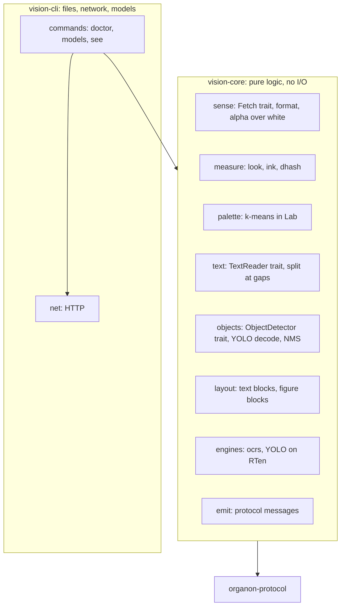

# organon-vision design

Status: **v0.1 (2026-11-14)**.

## Place in organon

Sense (get the image's bytes) and perception (located observations, no interpretation). A block is `text` or `figure`, never "title" or "chart"; an object's label is the model's, with its score. Meaning enters memory only through `mneme digest`. This organ depends on `organon-protocol` and nothing else from organon.

## Decisions

1. **Video and vision share by crate, not by copy.** organon-video measured keyframes (`frames::Features`: mean, white, ink, dhash) but had no OCR. Those measures are about images, so they moved here as `measure`, unchanged; a golden test pins the numbers bit for bit against organon-video 0.1. Next, organon-video depends on `organon-vision-core` (git tag) for its measures and for `screen_text` on graphic keyframes, through the library rather than the CLI, because it already has decoded frames in memory. The ARCHITECTURE rule "depend only on the protocol, never on another organ's internals" holds: the core crate is vision's public interface, not its internals. Not done in this step (it touches organon-video).
2. **Pure Rust engines.** ocrs runs on RTen, a CPU ONNX runtime written entirely in Rust, so CI builds on three OSes with no native libraries. The same runtime runs YOLO for objects. oar-ocr (PP-OCRv6, PP-DocLayout, multilingual) is stronger but needs ONNX Runtime binaries; it is the upgrade path behind the same traits.
3. **Layout from geometry first.** Model layout (DocLayout-YOLO, PP-DocLayout) names blocks; v0.1 only groups lines and finds figures, which needs no model and is testable. A model engine can later fill `role` with more values.
4. **Regions are `Location::Page { page: 1, bbox }` in pixels.** No protocol change: the protocol already says "documents, images: page 1".
5. **Transparent pixels are seen over white.** Diagrams on GitHub are often transparent PNGs; decoded as-is, transparent reads black (a real diagram came out 85 % black). White is how they show on a light page.
6. **Ids are stable.** Palette k-means has a fixed seed; measures and scores are rounded to three decimals. Perceiving the same image twice gives the same ids (tested).

## Perception

**Text.** ocrs detects words, groups them into lines and recognises each line. Its line grouping joins words across columns of a diagram ("kubelet kubelet kubelet" from three boxes), so lines are split where the gap between words exceeds 2 word heights; normal spacing is under half a height. Lone characters are dropped.

**Layout.** *Text blocks:* a line joins the nearest block above it when their columns overlap (or their left edges are within a line height), the gap is at most 1.2 line heights, and the heights differ by at most 1.6 times. A block records its median line height, the typographic size. *Figure blocks:* the image is shrunk to 512 px and cut into 16 px tiles; a tile is busy when 5 % of its pixels are edges (|dx| + |dy| > 40 in luma) and it is not covered by text. 4-connected busy tiles form a component; it is a figure if it fills at least 35 % of its bounding box (a panel's thin border does not) and covers at least 1 % of the image. Figures inside larger figures are dropped. Each figure's crop gets a `look`: `graphic` (thin strokes) or `scene` (photo).

**Palette.** k = 8 in CIE Lab at 200 px, merging colours closer than ΔE 8, dropping those under 1 %.

**Objects.** Letterbox to 640 (grey 114), output `[1, 4 + classes, anchors]`, best class per anchor at 0.35 or more, non-maximum suppression per label at IoU 0.45. Labels: `objects.labels` beside the model, else the 80 COCO classes.

## Real run (2026-11-14)

Six inputs: a photo (Ultralytics' bus), a book cover photo (ocrs' example), a VS Code screenshot, two architecture diagrams from GitHub (Kubernetes components, system-design-primer), a keyframe of a talk. 0.2–1.3 s per image in release. What broke and was fixed, each with a regression test: transparent backgrounds read as black; ocrs lines spanning diagram boxes; a strip of sky as a second figure inside the whole photo; the `.rten` model URLs answer 403 (ONNX ones work). A throwaway copy of the memory ingested the run (148 observations).

What it does well: the bus and four people at 0.83–0.94; headings and paragraphs of the screenshot as separate blocks with their sizes (37 px labels, 12–14 px code); diagram labels as separate lines.

## Known limits (next)

- **Latin script only** (ocrs). Multilingual text: oar-ocr or rusto-rs engines.
- **OCR on stylised text is poor** (bus advertising, glued labels like "kubeletkubelet").
- **Object models are trained on photos**: on diagrams they are rarely right (a "traffic light" at 0.54 on the Kubernetes diagram in an early run). Scores are there to judge by.
- **Figures in camera shots fragment** into several small `scene` blocks.
- **Typography is sizes only**: no font family, weight or monospace detection yet.
- **Reading order is top-to-bottom, left-to-right**, which interleaves columns that are not aligned.
- **Thresholds are tuned on six images.** They need a labelled set.

## Research

Run `tools-should-rust-vision-perception-organ` (organon-research, in mneme as `concept:image-perception`), building on the earlier OCR run (`open-source-ocr-reads-source-code`). Read: ocrs, RTen, oar-ocr, rusto-rs, ocr-rs, Tesseract, kmeans-colors, color_quant, usls, ort, tract, yolo-rs, DocLayout-YOLO, DocLayNet. Findings with verified passages: ocrs is pure Rust on RTen but Latin-only and early; oar-ocr has PP-OCR and PP-DocLayout but needs ONNX Runtime binaries; RTen is a CPU-only ONNX runtime in Rust; kmeans-colors finds dominant colours with k-means++ and sorts by frequency; layout analysis is mostly object detection trained on sets such as DocLayNet; Tesseract reads 100+ languages but is C++.
